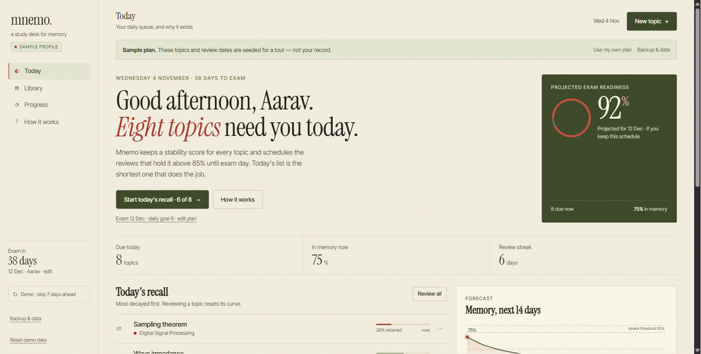
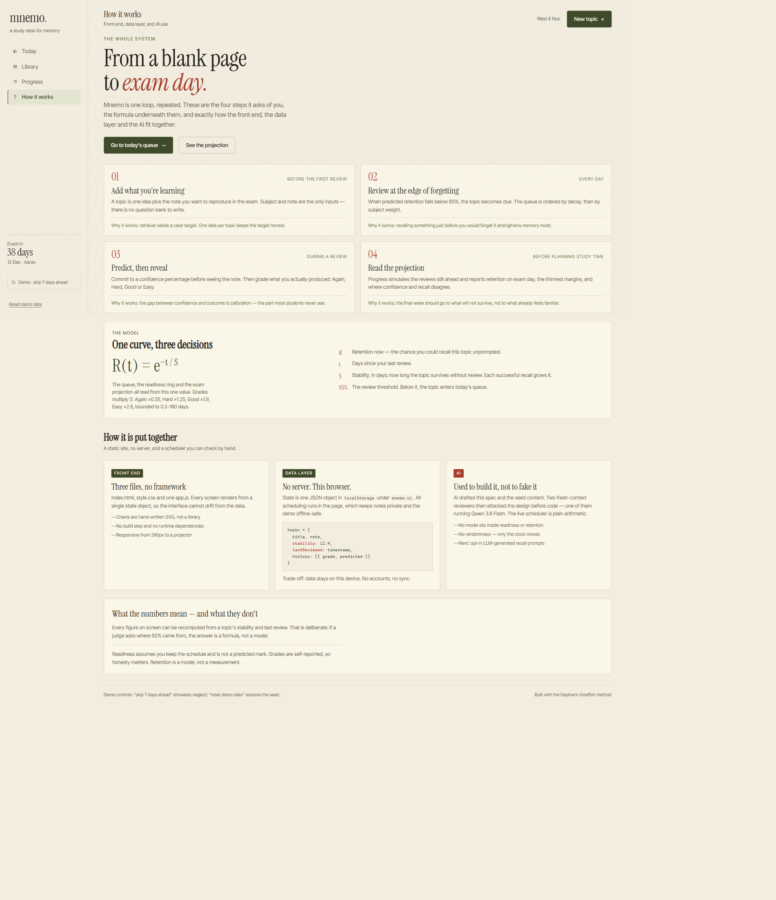
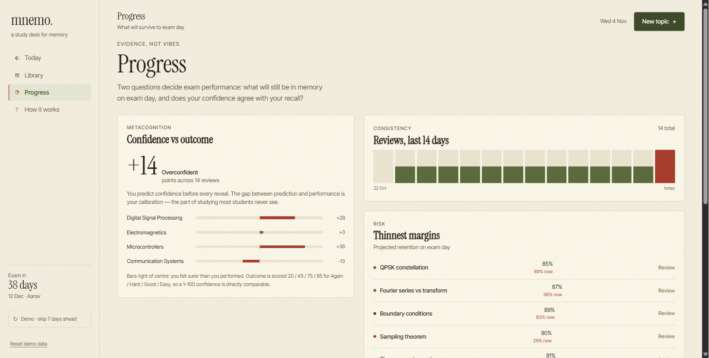
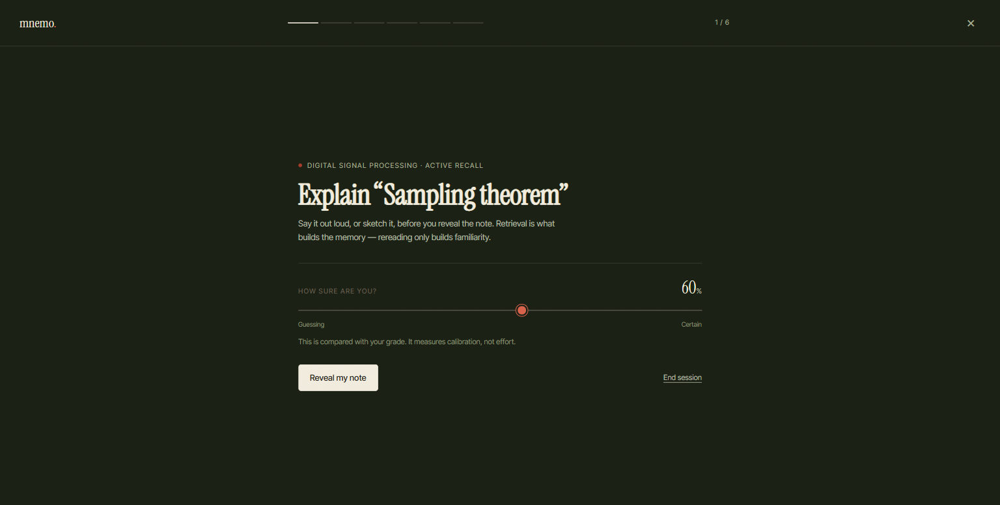

# Mnemo

**A study desk for memory.**

WEBNOVA '26 · Smart Education · Department of ECE, HKBK College of Engineering

Mnemo schedules revision by the forgetting curve instead of by a calendar. You add what you are learning, it tells you what is about to be forgotten, and it measures whether your confidence matches your actual recall.



---

## What it is

Rereading notes builds familiarity, not memory. Mnemo keeps a stability score for every topic, predicts when retention drops below 85%, and puts that topic in today's queue. Study time goes to what is actually leaking, and the Progress screen shows what will survive to exam day.

## Features

**Plan settings.** Name, exam date and daily review goal drive every number. Change the date and the queue, ring and projection recalculate immediately. Reachable from the sidebar, the Today plan link, or Backup & data.

**30-second setup.** Paste a list instead of typing topics one by one:

```
Z-transform & ROC | ROC is the set of z where X(z) converges.
Butterworth filter order | 3 dB at cutoff; rolls off 20n dB per decade.
Sampling theorem
```

A pipe or tab separates the topic from the note. `#` lines are ignored. Up to 200 topics at once, with duplicate detection and a new-subject field in the same dialog.

**Honest sample profile.** A first run ships with seeded ECE topics and invented review history, labelled in the sidebar and on Today. "Use my own plan" clears it and starts empty; the previous plan is kept locally as a rollback.

**Daily recall.** The queue is ordered by decay, then subject weight. A session asks you to explain the topic, predict confidence, reveal the note, and grade Again / Hard / Good / Easy. Buttons show the resulting next interval. Keys 1–4 grade, space reveals, and topics can be skipped without penalty.

**Calibration that waits for evidence.** Confidence is compared with the grade outcome (Again 20 / Hard 45 / Good 75 / Easy 95). The score is hidden until 8 honest reviews, because one review can swing it by 50 points.

**Progress.** Projected exam readiness, retention-to-exam curves (each dip is a scheduled review), thinnest margins with projected *and* current retention, and 14-day review activity.

**Backup and restore.** Export JSON, import it on another device, or restore the plan replaced by the last import/start-fresh. Every import keeps a local rollback and attempts a download first.

**Calendar reminders.** Export the next 21 days of due reviews as `.ics` for Google or Apple Calendar. Overdue topics are clamped to today, so the calendar never starts in the past.

**Installable and offline-capable.** `manifest.webmanifest` plus a service worker cache the app shell. Install from Chrome/Edge when served over http(s).

## Run it

Double-click `index.html`, or serve the folder:

```powershell
cd "E:\IEEE day contests\Mnemo"
python -m http.server 8080
# open http://localhost:8080
```

No build step, no dependencies, no API keys. State lives in `localStorage` under `mnemo.v1` (rollback under `mnemo.v1.backup`). Tested at 1280×720, 1536×776 and 390×844 in Chromium.

Some browsers block programmatic downloads from `file://`. Backup and calendar dialogs therefore include a **View / Copy** fallback that always works.

## 60-second demo

1. **Today** — sample banner, 8 due topics, readiness projected for 12 Dec. Point at the banner: the history is seeded, not the judge's.
2. **Start today's recall** → set confidence (say 80%) → reveal → press **3** (Good). Show the interval each grade would produce.
3. Finish → summary shows retention lift and the confidence gap.
4. **Progress** — calibration (sample-labelled), thinnest margins with current retention, retention-to-exam curves.
5. **Demo · skip 7 days ahead** — retention collapses from ~76% to ~28% and the queue refills. Reset restores the seed.
6. **Backup & data** — show JSON view, calendar `.ics`, and the start-my-own-plan path.

## How the math works

```
retention R(t) = e^(−t / S)
```

- `t` — days since the last review.
- `S` — stability in days. A grade multiplies it: Again ×0.35, Hard ×1.25, Good ×1.9, Easy ×2.8, bounded 0.2–180.
- A topic is due at **R < 0.85**.
- **Exam readiness** simulates the reviews still ahead to the exam date and reports where you land if you keep the schedule. The card also shows today's retained percentage, so projection and current state are never confused.
- **Calibration** compares predicted confidence with the grade outcome (Again 20 / Hard 45 / Good 75 / Easy 95).

Everything is plain arithmetic. Given the same stored state and the same day, the same numbers come out.

## How it is built

**Front end — three files, no framework.** `index.html`, `style.css`, one `app.js`. Every view renders from a single state object, so the interface cannot drift from the data. Charts are hand-written SVG. Fonts are the only network request, with serif/system fallbacks.

**Data layer — no server.** One JSON object in `localStorage`. All scheduling runs in the page, which keeps notes private and makes the demo offline-safe. The trade-off is honest: per-device data only, no accounts or sync.

**AI — used to build it, not to fake it.** AI drafted the specification and seed content, then two zero-context reviewers attacked the design before implementation using the Elephant–Goldfish method (one reviewer ran on Qwen 3.8 Flash). The runtime scheduler deliberately contains no model, so every score is reproducible and explainable. A sensible next step is opt-in LLM-generated recall prompts — not a hidden model in the readiness number.





**Limits.** Grades are self-reported, so honesty matters. Retention is a model, not a measurement. Readiness assumes the schedule is kept and is not a predicted mark. Data is per-browser; export a backup before switching devices.

## For the frontend team

- **State:** one object, shape `{ student, streak, subjects, topics, sample }`. Topic fields: `title`, `note`, `stability`, `lastReviewed`, `reps`, `history[]`. Don't rename the storage key without a migration in `loadState`.
- **Rendering:** one `render()` dispatcher; `renderToday`, `renderLibrary`, `renderInsights`, `renderGuide`. Add a view by adding a branch, a nav button, and a `crumbFor` entry, then guard `setView`.
- **Styling:** tokens are at the top of `style.css` (`--paper`, `--olive`, `--red`, `--line`). New surfaces should reuse `.card`, `.btn`, `.field`, `.micro`, `.display`.
- **PWA:** `sw.js` is cache-first. **Bump `CACHE` (`mnemo-v3`) on every deploy** or users will keep the old shell. Icons live in `assets/icon-192.png` and `icon-512.png`.
- **Testing:** verify at 390px and 1280px, keyboard the whole review loop, and run an axe pass. Current build: 0 axe violations.
- **Don't** claim AI is in the runtime scheduler; it isn't, and the guide says so.

## Files

| Path | Purpose |
|---|---|
| `index.html` | Shell, navigation, modal/review mounts, service worker registration |
| `style.css` | Design tokens and components |
| `app.js` | Memory engine, views, review session, backup/calendar, persistence |
| `manifest.webmanifest` | Install metadata |
| `sw.js` | Offline cache for the app shell |
| `assets/` | Screenshots and PWA icons |
| `docs/` | Product brief, design draft, redesign brief |

## Judging map

- **Functionality (35%)** — scheduler, persistence, topic CRUD, subject filters, search, keyboard grading, plan settings, bulk paste, backup/restore, calendar export, skip, demo fast-forward.
- **Relevance (20%)** — retention and exam preparation for students; nothing decorative.
- **UX (15%)** — four-step loop explained in-product, honest sample labelling, calibration gate, empty states, responsive, axe contrast clean.
- **Rapid execution & polish (15%)** — no build step, seeded demo, consistent olive/red system, no dead buttons.
- **Innovation (10%)** — forgetting-curve scheduling plus a metacognitive confidence-gap metric.
- **Pitch (5%)** — the demo above runs in under a minute.

Built with the [Elephant–Goldfish](https://github.com/google/elephant-goldfish-model) method: draft with full context, review with fresh ones.
